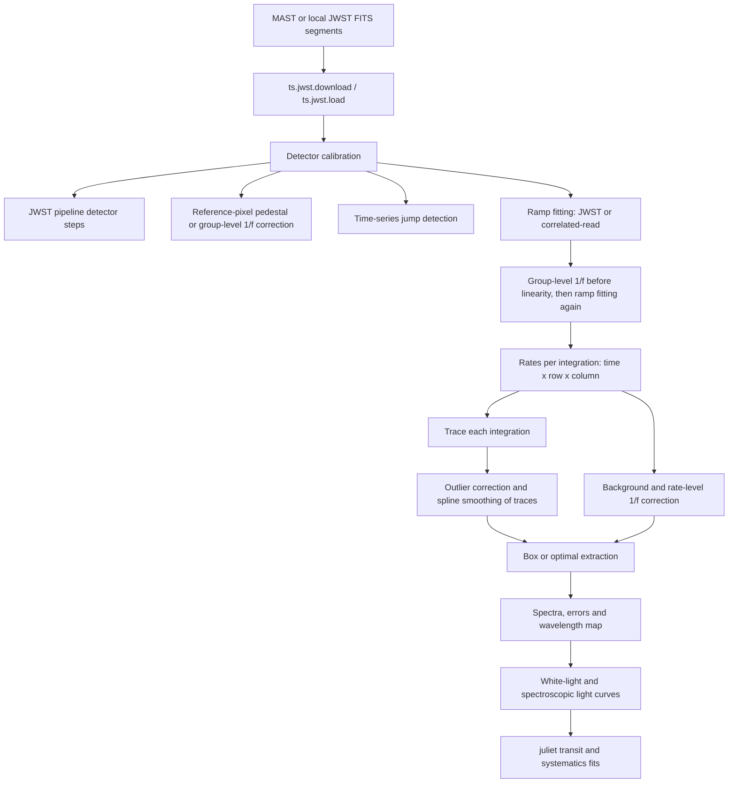

# Concepts and conventions

## Data flow

## Package layout

| Layer | Modules | Role |
|---|---|---|
| Algorithms | `transitspectroscopy.core` | Tracing, spatial profiles, box/optimal/blended extraction, shared profiles, photometry, ramp fitting, detector corrections, binning, products and provenance. Plain NumPy arrays; no JWST pipeline imports. |
| Observing modes | `transitspectroscopy.instruments` | One `Mode` per instrument mode with all its defaults; Stage 2 dispatches on it. |
| JWST | `transitspectroscopy.jwst`, `soss`, `miri`, `ramp_fitting` | Reading JWST datamodels, calwebb steps, the detector stage (`load`), Stage 2. |
| Runs | `transitspectroscopy.runner`, `config` | `ts.run(config)`, `ExtractionConfig`. |
| Historical interface | `spectroscopy`, `utils`, `timeseries`, `shared_profile`, `photometry` | The original function names, now thin layers over `core`. |

## Array conventions

All detector arrays keep the JWST orientation: the last axis is the detector column,
which is the dispersion direction for the supported spectroscopic modes.

| Product | Shape or form | Meaning |
|---|---:|---|
| JWST ramps | `(integration, group, row, column)` | Group-level detector samples (DN) |
| Rates / TSO | `(integration, row, column)` | Ramp-fit rates per integration (DN/s) |
| Trace | `x: (column,)`, `y: (column,)` or `(integration, column)` | Cross-dispersion centre at each detector column |
| Extracted spectra | `(integration, column)` | Flux and error at each dispersion pixel |
| Marsh profile `P` | `(row, column)` | Normalized spatial light fraction in the aperture |
| Optimal spectrum | `(3, column)` | Column index, flux and **inverse variance** |
| Light-curve input | dict with `times`, `flux`, `error` | Optional `GP_external_parameters` and `linear_external_parameters` |
| Stage outputs | nested dictionaries | Metadata, arrays, traces, spectra and white-light curves |

Times are BJD_TDB at mid-integration, read from the JWST `INT_TIMES` table.

## Data quality and masked pixels

JWST data-quality (DQ) flags are preserved. The legacy extraction routines mark masked pixels
with the value `-9999`; the newer routines also accept explicit boolean masks. Masked pixels
carry no weight in profile fitting or extraction. Ramp error arrays may be absent in JWST 3
products; `load.ramps_err_available` says which integrations have them.

## Uncertainties

Extraction errors are conditional on the fitted spatial profile: they do not include the
uncertainty of the profile itself, nor covariances between columns or integrations that
background and 1/f corrections can introduce. Each guide states which uncertainties are
propagated.
