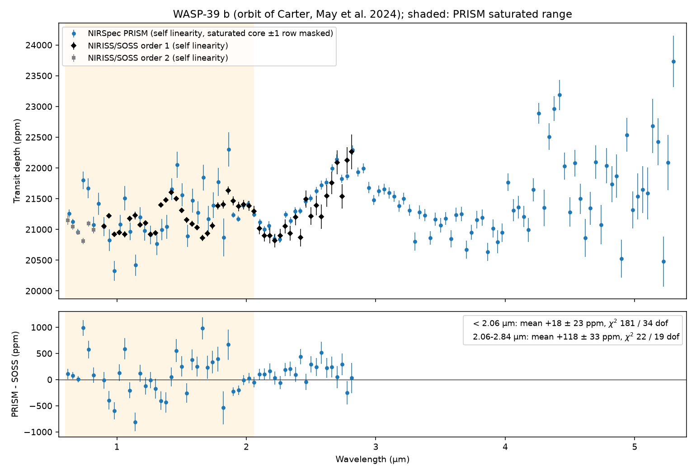
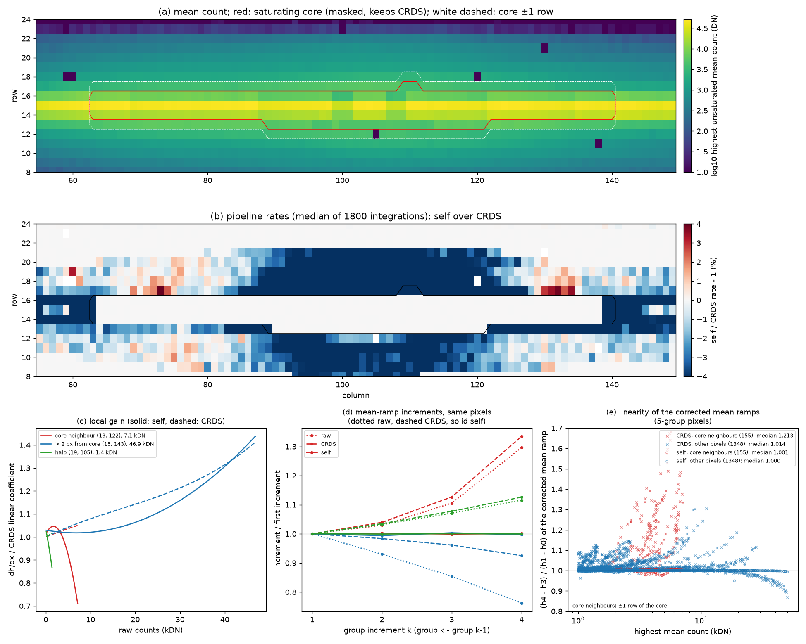

# WASP-39 b: NIRSpec PRISM vs NIRISS/SOSS with the self non-linearity correction

Test of whether the self non-linearity correction (`detector_calibration(self_linearity=True)`,
`docs/guides/self-linearity.md`) fixes the saturated range of the WASP-39 b PRISM transmission
spectrum, against NIRISS/SOSS. Data: ERS 1366, PRISM observation 4 (jw01366004001_04101_00001,
NRS1 SUB512, 21500 integrations x 5 groups) and SOSS observation 1 (jw01366001001_04101_00001,
537 integrations x 9 groups). Orbit fixed to Carter, May et al. 2024 (arXiv:2407.13893, Table
1): P = 4.0552842 d, a/R* = 11.390, i = 87.7369 deg, e = 0, T0 2459771.335647 (PRISM) and
2459787.5567843 (SOSS, BJD TDB). All numbers below are from these runs; the log of the study is
in `Claude_progress.md` (October 2026 entries).

## Results



PRISM - SOSS on their common 0.04 um bins (SOSS order 2 for 0.60-0.84 um, order 1 for 0.88-2.84
um), against SOSS with the self correction; < 2.06 um is the PRISM saturated range (35 bins),
2.06-2.84 um is above it (20 bins):

| PRISM | < 2.06 um: mean (ppm) | rms (ppm) | chi2 | 2.06-2.84 um: mean (ppm) | chi2 |
|---|---|---|---|---|---|
| CRDS | +140 +- 12 | 779 | 2024 | +189 +- 33 | 36 |
| self | -254 +- 12 | 608 | 2141 | +117 +- 33 | 22 |
| CRDS, saturated core masked | +2522 +- 20 | 2224 | 13413 | +189 +- 33 | 36 |
| self, saturated core masked | -56 +- 19 | 410 | 379 | +117 +- 33 | 22 |
| CRDS, core +-1 row masked | +772 +- 24 | 785 | 1236 | +189 +- 33 | 36 |
| **self, core +-1 row masked** | **+18 +- 23** | **411** | **181** | +118 +- 33 | 22 |
| hybrid (shared correction on the core) | +804 +- 13 | 1946 | 9048 | +117 +- 33 | 22 |

1. **The self correction alone does not fix the saturated range.** Deep PRISM dips at 0.94,
   1.06 and 1.3 um (down to about -2000 ppm) remain with both CRDS and self. Above saturation
   the self correction improves the agreement (chi2 36 -> 22). The self correction makes the
   PRISM white-light depth 343 +- 3 ppm shallower than CRDS (20969 vs 21319 ppm; SOSS order 1:
   -56 +- 1 ppm, 21164 vs 21219 ppm).
2. **Masking the saturating pixels fixes it, but only with the self correction.** 270 pixels
   saturate in more than 0.1% of the integrations: the trace core, columns 63-140, up to 5 per
   column. The other 358 pixels that saturate at some point are cosmic-ray hits. Masking the core
   (and the rows next to it) in every integration removes the dips: PRISM - SOSS +18 +- 23 ppm,
   rms 411 ppm. Some excess scatter remains (chi2 of about 5 per bin). With CRDS, masking makes
   the spectrum much worse.
3. **Why: charge spilled from the saturated pixels.** In the raw mean ramps, the pixels next to
   the core and a faint halo up to ~7 rows from it (columns ~90-125, where the core saturates
   earliest) accelerate. One halo pixel at only 1.4 kDN has its last group increment 12% above
   its first, which no count-dependent non-linearity explains. CRDS keeps this acceleration
   (median (h4-h3)/(h1-h0) of the core neighbours 1.21); the per-pixel self fit removes it
   (1.001) and lowers those rates by 4-10%. Once the core is masked, these pixels carry the flux
   of the saturated columns, so the outcome depends on how well they are corrected.
4. **A correction shared by all pixels (counts alone) does not work.** It is needed for the 258
   early-saturating pixels, which have fewer than the 5 groups a per-pixel cubic needs. Fitted on
   2352 pixels: a2 = 0.0639, a3 = 0.0144, top 52748 DN, nearly independent of the minimum counts.
   It leaves 3.3% pixel-to-pixel rms in the linearity of bright 5-group pixels (per pixel: 0.12%,
   CRDS: 5.0%), as does a shared residual on top of CRDS. Applied to the core through the
   pipeline ('hybrid'), it is worse than CRDS (chi2 9048).



Panels of `pixels_self_vs_crds.png`:

- (a) mean counts, with the masks outlined;
- (b) pipeline rates, self over CRDS (the core keeps CRDS in both);
- (c) local gain dh/dx of three example pixels;
- (d) their mean-ramp group increments, raw, CRDS and self;
- (e) the linearity of the corrected mean ramps of every 5-group pixel.

## Pipeline choices and caveats

- **Stage 1:** package flow (`ts.jwst.load`, `detector_calibration` with TSO jump, `fit_ramps`
  with the group 1/f correction before linearity). It runs in chunks of 1/3 of a segment
  (memory, 8 GB). Each chunk's group 1/f template is aligned to the first chunk's (the column
  median over background pixels of the difference is removed), so the template's 1/f imprint is
  the same throughout.
- **One-group ramps are kept** (`parameters['ramp_fit']['suppress_one_group'] = False`).
  Pixels that saturate after group 0 in some integrations would otherwise lose their flux in
  those integrations: the white light jumped by +-1.2% between integrations.
- **Stage 2:** the SATURATED bit is cleared before `stage2(mask_dq=True)`. A rate fitted from
  the unsaturated groups is valid, but keeps the flag.
- **PRISM:** box extraction, with the traces of the first CRDS segment reused for every segment
  and variant. `AssignWcsStep` fails on PRISM with jwst 3.0.0, stdatamodels 6.0.0 and astropy
  7.2.2 (`Rotation3DToGWA.evaluate`); it is patched in `wasp39_stage2.py` only. Wavelengths agree
  with the STScI x1dints to 2e-4 um (median).
- **SOSS:** the package's joint (deblended) optimal extraction. Box extraction loses order 1
  above 2.13 um, where the orders overlap.
- **Self correction:** one fit per exposure, from the mean ramps of all chunks (2196 PRISM
  pixels, 117611 SOSS pixels). Pixels with fewer than 5 unsaturated groups keep CRDS.
- **Light curves:** fitted by least squares, with the orbit fixed and a linear baseline. The
  quadratic limb darkening (q1, q2) is free in every bin, because ExoTiC-LD, which the paper
  used, is not installed here. Errors are scaled by the residual scatter and a time-averaging
  beta factor. Depth differences between two variants of the same mode are paired, from
  light-curve ratios. The first 1000 PRISM integrations (a settling ramp) are left out.
- **Comparison with the paper:** this reproduces the analysis, not the published spectra point
  by point; their tabulated values were not compared.

## Files

| File | Purpose |
|---|---|
| `wasp39_stage1.py` | Stage 1 of a chunk: `crds`, `fit` (self fit), or a named variant with a coefficients file |
| `wasp39_combine_fit.py` | One self fit per exposure from the chunk mean ramps |
| `wasp39_stage2.py` | PRISM stage 2 of a segment (optional static mask) |
| `wasp39_soss_stage2.py` | SOSS extraction (box or joint optimal) |
| `wasp39_spectrum.py` | White and binned light-curve fits; paired differences |
| `wasp39_compare.py` | PRISM - SOSS statistics and figure for any PRISM variants |
| `wasp39_saturation_mask.py` | Static mask of the pixels that saturate in > 0.1% of the integrations |
| `wasp39_global_fit.py` | Counts-only correction shared by all pixels, and the hybrid map |
| `wasp39_final_figure.py`, `wasp39_pixels_figure.py` | The two figures above |
| `wasp39_prism.sh`, `wasp39_prism_masked.sh`, `wasp39_soss.sh`, `watchdog.sh` | Drivers (sequential) and a memory/disk watchdog |
| `results/*_spectrum_*.npz` | Spectra of every variant (depth, error, limb darkening, residuals, paired differences) |
| `results/prism_vs_soss.*`, `results/prism_followups*.*` | Comparisons (figures and JSON) |
| `results/prism_self_linearity.npz`, `results/prism_global_linearity.npz` | PRISM self fit (with mean ramps) and the shared correction |
| `results/saturation_mask_*.npy` | The two masks |

## Reproduce

Run from the repository root (`PYTHON` selects the interpreter; raw data in
`validation/data/wasp39_{prism,soss}/`; outputs in `validation/runs/wasp39/`, about 25 GB of rates):

```sh
bash validation/wasp39/wasp39_prism.sh                 # self fit, CRDS and self stage 1 + 2
bash validation/wasp39/wasp39_soss.sh
bash validation/wasp39/wasp39_prism_masked.sh crds self
python validation/wasp39/wasp39_global_fit.py validation/runs/wasp39/prism/self_linearity.npz \
    validation/runs/wasp39/prism/global_linearity.npz validation/runs/wasp39/prism/hybrid_linearity.npz
bash validation/wasp39/wasp39_prism.sh hybrid validation/runs/wasp39/prism/hybrid_linearity.npz
python validation/wasp39/wasp39_compare.py validation/runs/wasp39 out.png out.json \
    crds self self_core self_grow1 hybrid
```

`wasp39_soss.sh` runs the SOSS self fit, stage 1 and box extraction. The spectra used here come
from the joint optimal extraction, `wasp39_soss_stage2.py validation/runs/wasp39/soss <variant>
<prefix> optimal`, which writes `<prefix>_order1.npz` and `_order2.npz`. The PRISM spectra are
fitted with `wasp39_spectrum.py prism <out> <spec_seg00{1,2,3,4}.npz> --edges
0.60,0.64,...,5.32 --skip 1000`, and the SOSS spectra with `wasp39_spectrum.py soss`, 0.04 um
bins (order 1: 0.88-2.84 um; order 2: 0.60-0.84 um).
